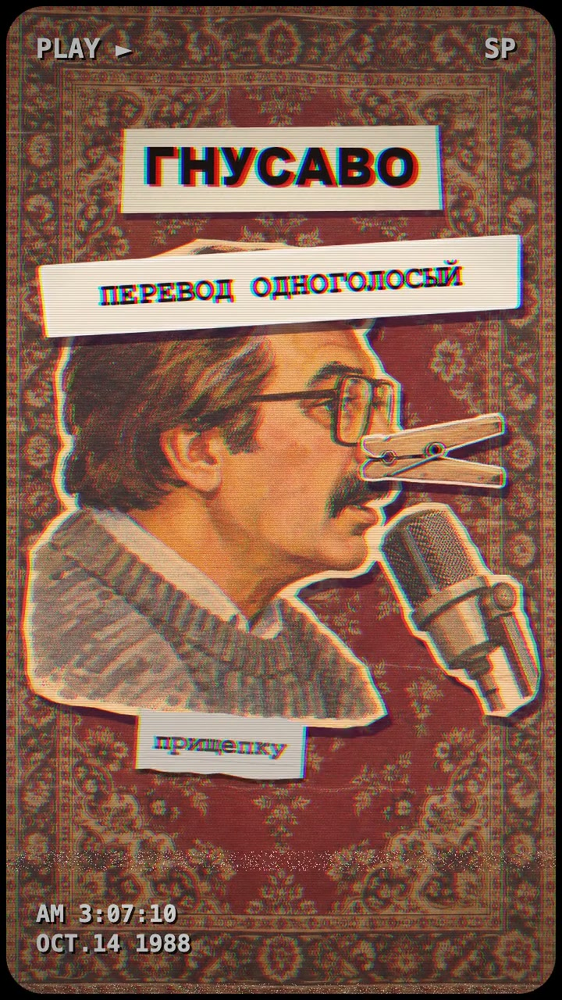
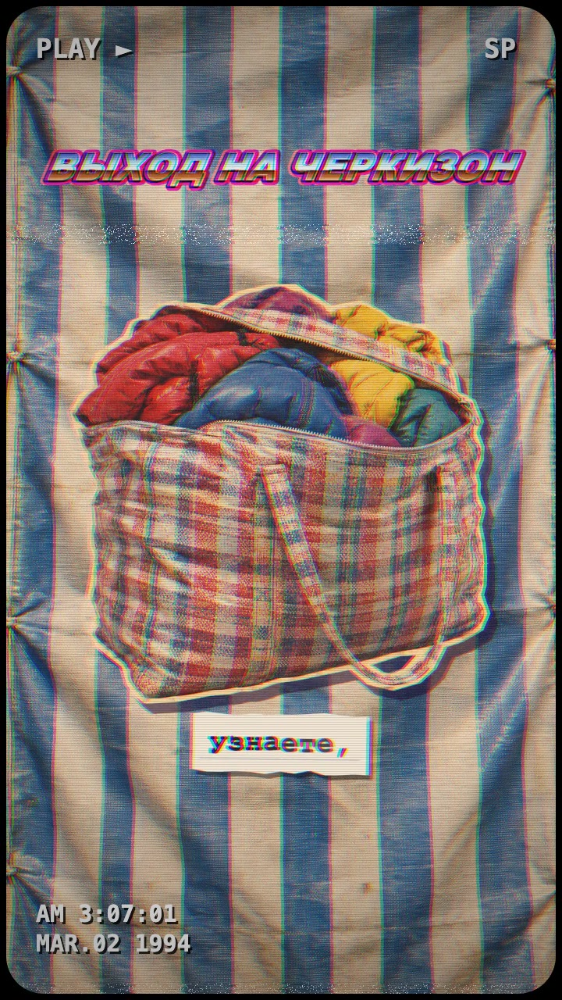
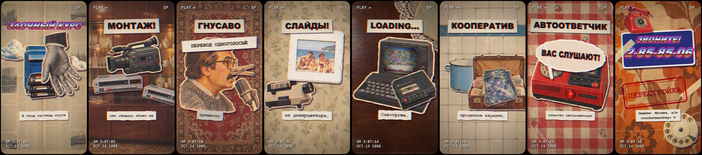
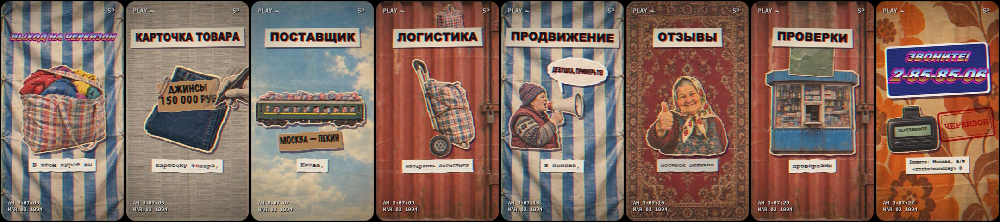

# 📼 Инфобиз-1989 — «Кооператор» и «Черкизон»

**Реклама онлайн-курсов 2020-х, записанная на видеокассету на рубеже 80-х и 90-х. Бумажный коллаж, телемагазин с VHS, гнусавый переводчик — и ни одного кадра видеогенерации: всё собрано кодом из вырезок.**

<table><tr>
<td align="center"><a href="docs/kooperator.mp4"></a><br><b><a href="docs/kooperator.mp4">▶ «Кооператор»</a></b></td>
<td align="center"><a href="docs/cherkizon.mp4"></a><br><b><a href="docs/cherkizon.mp4">▶ «Черкизон»</a></b></td>
</tr></table>

<p align="center">автор — Андрей Овчаренко · <a href="https://t.me/Amovcharenko">tg @Amovcharenko</a> · <b><a href="https://t.me/andreydraft">📣 канал @andreydraft</a></b></p>

---

## 💡 Идея

Взять сегодняшнюю рекламу инфобиза — «в этом курсе вы узнаете, как…» — и перенести её в позднесоветский телемагазин. Все обещания те же, только реквизит из своего времени.

**«Кооператор»** — заочный курс «всего и сразу»: снимать видео на камеру и монтировать на двух видиках, озвучивать кино гнусавым голосом через прищепку, делать презентации на диапроекторе, программировать с загрузкой игр с магнитофона, открыть кооператив, клеить объявления с отрывными телефонами, поставить автоответчик и вывезти валюту за границу. В финале — «ЗВОНИТЕ!», номер набирается диском по цифре.

**«Черкизон»** — курс по выходу на маркетплейс, только маркетплейс — это рынок: карточка товара — картонка с ценой маркером, поставщик в Китае — вагон «Москва — Пекин», логистика — баул вылетает из окна поезда, падает на гружёную тележку, и у той от перегруза отлетает колесо, продвижение — тётка с мегафоном, отзывы — «у соседки брала», проверки и налоги — киоск, счёты и калькулятор. В финале вместо телефона — пейджер.

Каждая фраза диктора — один гэг: вырезки падают, шлёпаются, их хватает рука, сверху бьют штамп.





## 🎵 Звук

- Текст в жанре «продающего» закадра, озвучен синтезированным голосом диктора
- Одна реплика в каждом ролике — гнусавый одноголосый «перевод», как на пиратской кассете: второй голос, собранный с нуля, без клонирования
- Музыкальная подложка и шумы (шлепок, штамп, перемотка, звонок, набор диска) сгенерированы и сведены под гэги
- По дорожке сняты тайминги слов ([`clips/*/align.json`](clips/)); по ним появляются субтитры и приходят удары

## 🎨 Визуал

- **Как собиралось:** сценарий → голос → картинки-вырезки → якоря и раскладка → движок на canvas → экспорт. Каждый предмет — отдельная вырезка с белой кромкой, фоны — ковёр, клеёнка, обои, брезент рынка, контейнер
- **Стоп-моушн.** Всё двигается с шагом 12 кадров в секунду, и на каждом шаге каждую вырезку заново чуть сдвигают и поворачивают, как будто её переложили рукой. Входы: падение с отскоком, шлепок, штамп, вылет сбоку, веер, прыжок
- **Якоря.** У вырезок размечены точки ([`anchors.json`](anchors.json)): дверца почтового ящика, щель видика, экран телевизора, окошко киоска, дисплей калькулятора. Кассета уходит в щель, рука держит за край, картинка встаёт ровно в стекло экрана
- **Экраны.** Картинка на телевизоре натягивается на четырёхугольник стекла сеткой из треугольников с выпуклостью кинескопа, виньеткой и бликом; на калькуляторе и пейджере — ЖК-цифры
- **VHS.** Сдвиг цветовых каналов, ползущая полоса трекинга, строки развёртки, выцветшая плёнка, зерно, экранное меню видика `PLAY ►` / `◄◄ REW` с часами и датой
- **Буквы.** Заголовок гэга — вырезка газетного заголовка, название курса и финал — хромированные буквы в духе 80-х; субтитры — полоска бумаги с машинописью, у переводчика — серая
- **Кадр под вертикальные ленты.** Заголовок сверху, субтитры по центру, весь текст — внутри безопасных зон Reels и Shorts
- **Рендер** — headless Chrome кадр за кадром, 720×1280, 24 fps, ffmpeg

## 🚧 Самое трудное

Чтобы коллаж не выглядел как наклейки поверх фона, вырезки должны взаимодействовать: кассета — входить в щель и прятаться за корпусом, матрёшка — раскрываться и выпускать то, что внутри, отрывные листки — тянуться гирляндой от объявления к руке. Для этого каждая такая связка держится на размеченных точках двух картинок, и одна вырезка едет вместе с другой, а не просто стоит рядом.

Текст и вертикальный кадр. Заголовок, субтитры и финальная табличка должны не пересекаться с предметами и не залезать под интерфейс Reels и Shorts. Поэтому вся сцена живёт в полосе между заголовком и субтитрами, а субтитры ужимаются в одну строку по центру, левее колонки кнопок.

## Что внутри

| Путь | Что это |
|---|---|
| [`index.html`](index.html) | Страница с канвасом 720×1280; `?clip=kooperator` или `?clip=cherkizon` |
| [`collage.js`](collage.js) | Общий движок: вырезки, анимация, экраны, VHS, субтитры, финал |
| [`clips/kooperator/`](clips/kooperator/), [`clips/cherkizon/`](clips/cherkizon/) | Сцена клипа (гэги, слои, тайминги), тайминги слов и звук |
| [`anchors.json`](anchors.json) | Размеченные точки вырезок: за что держать, куда вставлять, где экран |
| [`assets/`](assets/) | Вырезки (PNG) и фоны (JPG) обоих клипов |
| [`render.mjs`](render.mjs) | Рендер кадров в headless Chrome и сборка MP4 через ffmpeg |
| [`docs/`](docs/) | Постеры, ленты кадров и оба клипа 720×1280 |

## Рендер

Нужны Node.js, Google Chrome и ffmpeg. Chrome берётся из `/Applications`; в другом месте — укажи путь в `CHROME=...`.

```bash
npm install
node render.mjs kooperator --sheet   # контакт-лист из 6 кадров -> out/kooperator_sheet.png
node render.mjs kooperator           # весь клип -> out/kooperator.mp4 (720×1280, 24 fps, со звуком)
node render.mjs cherkizon            # то же для «Черкизона»
```

Посмотреть вживую: `python3 -m http.server 8000`, открыть `http://localhost:8000/?clip=cherkizon` и в консоли вызвать `frame(12.5)` — страница нарисует кадр на любой секунде.

---

⭐ Понравилось — поставь звезду репе, это лучший способ сказать спасибо. Больше таких экспериментов — в телеграм-канале **[@andreydraft](https://t.me/andreydraft)**.
